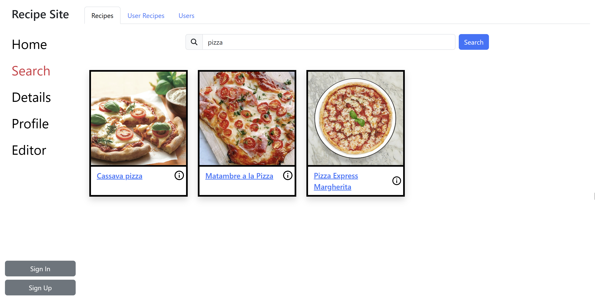
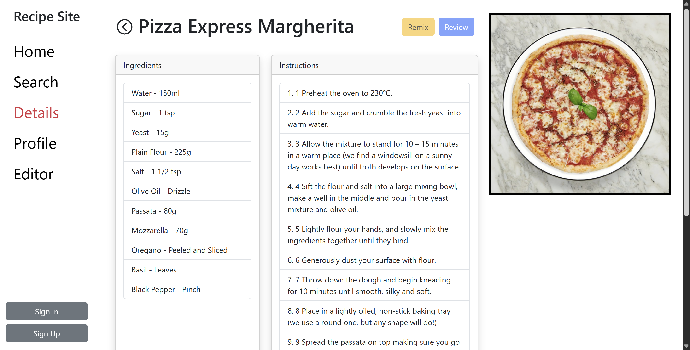

# Recipe Site Frontend

This is the Next.js frontend for a recipe sharing social network. The application lets users create accounts, discover new recipes, write and share their own recipes, and review other users' recipes.

This repository contains the web client only. For the API, see [Recipe Site backend](https://github.com/Aaron-Detre/recipe-site-backend).

Searches for external recipes use [TheMealDB](https://www.themealdb.com/).

## Screenshots

### Recipe Search

### Recipe Details

## Features

- Search TheMealDB recipes, community recipes, and users
- Create and remix recipes with standard or scalable ingredients
- Read and write recipe reviews
- Follow other users and view their profiles

## Built With

- Next.js and React
- TypeScript
- Redux
- React Bootstrap
